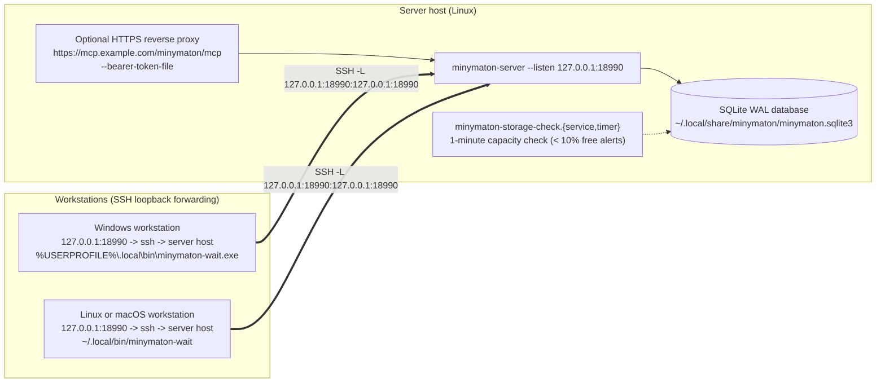

# Minymaton Operator Deployment Guide

This document describes how to install `minymaton-server` and its helpers,
deploy a shared server, and monitor its storage.

## Deployment Topologies

`minymaton-server` binds only to a loopback address (`--listen 127.0.0.1:PORT`). Remote workstations and external HTTPS clients reach a loopback listener either through an SSH local port forward or through an authenticated reverse proxy on the same host.



### 1. Shared loopback server

Run one `minymaton-server` per queue, for example as a systemd user service:

- **Loopback listener:** `127.0.0.1:18990` (`/mcp` and `/mcp/agent/<name>`).
- **Durable SQLite WAL database:** for example `~/.local/share/minymaton/minymaton.sqlite3`, kept across binary upgrades.
- **Filesystem capacity monitoring:** `deploy/minymaton-storage-check.service` and `deploy/minymaton-storage-check.timer` check the database's filesystem every minute and post low-space (`< 10%` free) and recovery transitions to the webhook in `~/.config/minymaton/webhook` (mode `0600`), persisting state in `~/.local/state/minymaton/storage.json`.
- **Workstations:** forward a local port to the server's loopback listener, for example `ssh -N -L 127.0.0.1:18990:127.0.0.1:18990 server-host`, and install the `minymaton-wait` helper matching the workstation's target.

### 2. HTTPS behind a reverse proxy

To serve clients that cannot use SSH, run a reverse proxy on the server host that terminates TLS and forwards to the loopback listener:

- **Endpoint:** for example `https://mcp.example.com/minymaton/mcp` (and `/minymaton/mcp/agent/<name>`).
- **Authentication:** start the server with `--bearer-token-file` (only SHA-256 token digests are kept in memory).
- **Long polls:** a parked `receive` holds its request open until a commit arrives, so the proxy and anything in front of it must not cut idle requests short.

### 3. Install the public server and helpers

The public `AGPL-3.0-only` SQLite packages are published on
[crates.io](https://crates.io/crates/minymaton), with source and build
instructions in [immutlex-dev/minymaton](https://github.com/immutlex-dev/minymaton).
Install the server, waiter and storage checker together:

```sh
cargo install --locked --version 0.1.2 minymaton-server
```

This compiles for the host OS and architecture; see the root README for native
build prerequisites. `cargo install minymaton` installs only the server under
the shorter command name. The portable waiter remains available as
[`tools/minymaton-wait.py`](../tools/minymaton-wait.py) in source.

There is no separate hosted binary download site. Operators distributing their
own qualified binaries can still use `tools/stage_helpers.py` to assemble a
local bundle with corresponding source, license and checksums.

## Storage Architecture

Minymaton separates its MCP queue coordinator (`Queue` + `Signals` in `minymaton-core`) from durable storage through the `QueueStore` and `QueueReader` traits:

- **Bundled backend:** `Queue::open` runs a single-node `minymaton-server` over a local SQLite WAL database (`synchronous=FULL`, `busy_timeout=0`, one writer connection plus a concurrent read-only `Reader`), in `crates/minymaton-core/src/store.rs`.
- **Other backends:** `Queue::with_backend` accepts any implementation of `QueueStore` and `QueueReader`. `Signals` wake receives parked in the same process; a backend shared by several server processes must also raise them from the other processes' commits.
