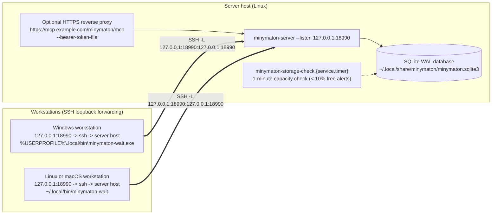

# Minymaton Operator Deployment Guide

This document describes how to deploy `minymaton-server`, monitor its storage,
and stage the public helper distribution bundle.

## Deployment Topologies

`minymaton-server` binds only to a loopback address (`--listen 127.0.0.1:PORT`). Remote workstations and external HTTPS clients reach a loopback listener either through an SSH local port forward or through an authenticated reverse proxy on the same host.



### 1. Shared loopback server

Run one `minymaton-server` per queue, for example as a systemd user service:

- **Loopback listener:** `127.0.0.1:18990` (`/mcp` and `/mcp/agent/<name>`).
- **Durable SQLite WAL database:** for example `~/.local/share/minymaton/minymaton.sqlite3`, kept across binary upgrades.
- **Filesystem capacity monitoring:** `deploy/minymaton-storage-check.service` and `deploy/minymaton-storage-check.timer` check the database's filesystem every minute and post low-space (`< 10%` free) and recovery transitions to the webhook in `~/.config/minymaton/webhook` (mode `0600`), persisting state in `~/.local/state/minymaton/storage.json`.
- **Workstations:** forward a local port to the server's loopback listener, for example `ssh -N -L 127.0.0.1:18990:127.0.0.1:18990 server-host`, and install the `minymaton-wait` helper matching the workstation's target.

### 2. HTTPS behind a reverse proxy

To serve clients that cannot use SSH, run a reverse proxy on the server host that terminates TLS and forwards to the loopback listener:

- **Endpoint:** for example `https://mcp.example.com/minymaton/mcp` (and `/minymaton/mcp/agent/<name>`).
- **Authentication:** start the server with `--bearer-token-file` (only SHA-256 token digests are kept in memory).
- **Long polls:** a parked `receive` holds its request open until a commit arrives, so the proxy and anything in front of it must not cut idle requests short.

### 3. Public helper and server distribution (`https://dl.scritty.dev/minymaton/`)

`tools/stage_helpers.py` packages the complete `AGPL-3.0-only` public bundle served at `https://dl.scritty.dev/minymaton/`:

- `minymaton-wait-x86_64-unknown-linux-gnu`
- `minymaton-wait-aarch64-unknown-linux-gnu`
- `minymaton-wait-x86_64-apple-darwin`
- `minymaton-wait-aarch64-apple-darwin`
- `minymaton-wait-x86_64-pc-windows-msvc.exe`
- `minymaton-wait-aarch64-pc-windows-msvc.exe`
- `minymaton-server-x86_64-unknown-linux-gnu`
- `minymaton-server-aarch64-unknown-linux-gnu`
- `minymaton-server-x86_64-apple-darwin`
- `minymaton-server-aarch64-apple-darwin`
- `minymaton-server-x86_64-pc-windows-msvc.exe`
- `minymaton-server-aarch64-pc-windows-msvc.exe`
- `minymaton-wait.py` (portable Python 3 stdlib-only waiter)
- `source.tar.gz` (exact Git source archive corresponding to the staged binaries)
- `LICENSE` (`AGPL-3.0-only`)
- `README.txt`
- `stage_helpers.py`
- `SHA256SUMS`

To stage a fresh bundle from a directory holding the 12 qualified binaries:

```sh
python3 tools/stage_helpers.py --out-dir /path/to/helper-bundle --repo-root .
```

## Storage Architecture

Minymaton separates its MCP queue coordinator (`Queue` + `Signals` in `minymaton-core`) from durable storage through the `QueueStore` and `QueueReader` traits:

- **Bundled backend:** `Queue::open` runs a single-node `minymaton-server` over a local SQLite WAL database (`synchronous=FULL`, `busy_timeout=0`, one writer connection plus a concurrent read-only `Reader`), in `crates/minymaton-core/src/store.rs`.
- **Other backends:** `Queue::with_backend` accepts any implementation of `QueueStore` and `QueueReader`. `Signals` wake receives parked in the same process; a backend shared by several server processes must also raise them from the other processes' commits.
